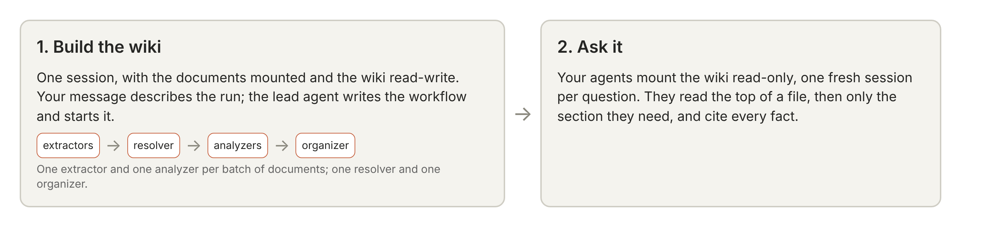
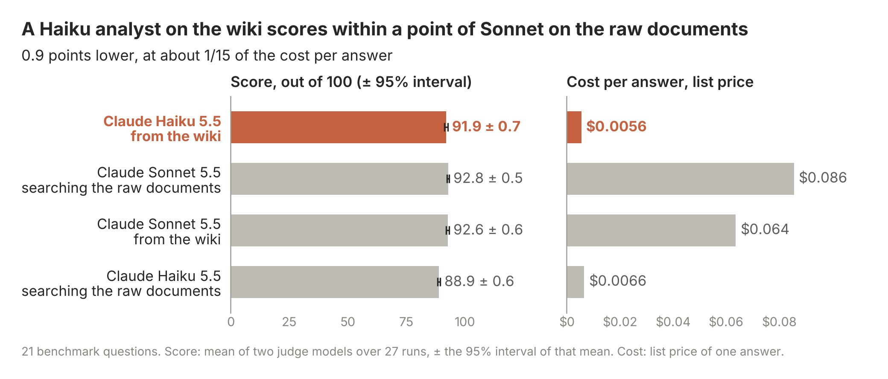
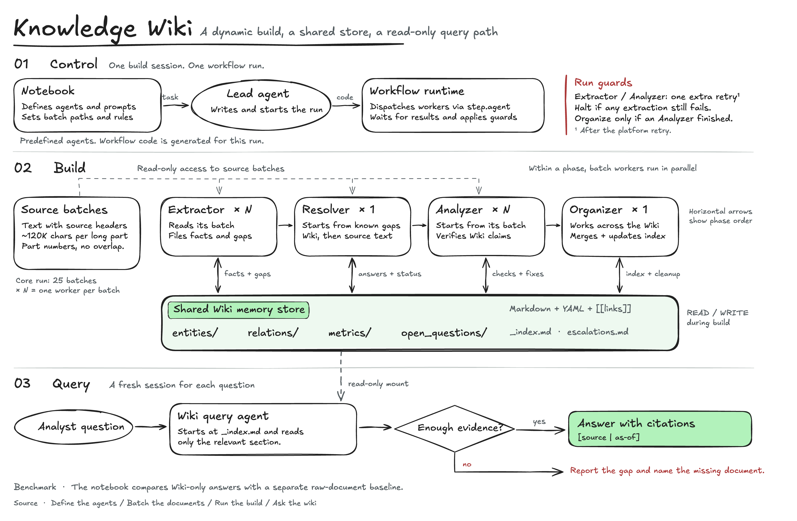
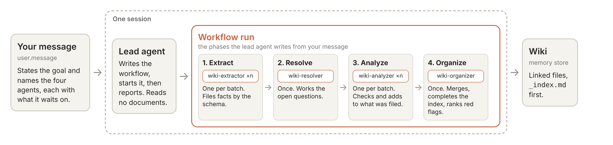
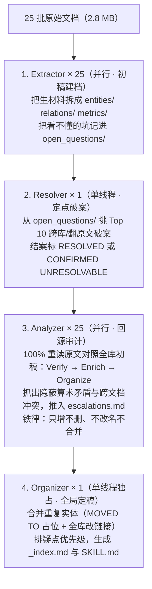
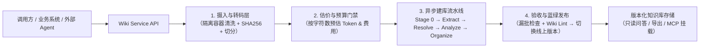

# Knowledge Wiki 深度解析：动态工作流构建原理、提示词工程与通用服务化架构

> 本文基于 [distill_documents_into_knowledge_wiki.zh-CN.ipynb](../distill_documents_into_knowledge_wiki.zh-CN.ipynb) 与项目源码整理，完整覆盖：**核心范式 → 建库 7 步主线 → 动态编排与多 Agent 协作拆解 → 提示词工程 6 大核心设计 → 实测结论与边界 → 通用 Knowledge Wiki 服务 / API 架构设计**。

---

## 一、核心问题与整体范式

### 1.1 为什么不能每次都直接检索原始文档
当 AI 助手反复基于同一批**缓慢变化的文档**（如并购尽调资料室、法律证据开示、大型技术/产品文档库）回答问题时，传统“每次提问直接搜原文”存在两大硬伤：

1. **重复计算成本高**：同一批几百万字的资料反复问 100 次，AI 就要从头翻阅 100 遍，慢且贵。
2. **光靠搜索片段拼不出跨文档的真相**：很多关键事实散落在多份文件之间：
   - **同一指标、不同口径**：公司年报按非 GAAP 披露的 2023 EBITDA 是 2.354 亿美元，内部分析笔记按信贷协议口径估算是约 2.52 亿美元，直接检索很容易把两者混为一谈。
   - **同一公司、多个名字**：法律文件里叫 `Squarespace, Inc.`，正文里自称「本公司」，董事会 PPT 里为了保密使用项目代号 `Pacific`。
   - **条款修订覆盖旧值**：5 月签约写的是每股 44.00 美元，9 月修订协议涨到了 46.50 美元，两份文件同时躺在资料室里。

### 1.2 两阶段架构：读一次，查无数次



1. **构建知识库（Build the wiki）**：在 Claude Managed Agents 中运行一次**动态工作流**，派出多 Agent 小队把所有文档彻底精读一遍，整理成纯 Markdown 格式的知识库（存放在平台的记忆存储 Memory Store 里）。每条事实带出处与日期；冲突保留不强行抹平；过期数字标明失效时间。
2. **向知识库提问（Ask it）**：答题助手以**只读方式**挂载知识库，每个问题开启一个干净的新会话，按目录渐进查阅，不再翻阅原始文档。

### 1.3 官方基准测试效果



官方围绕示例资料室准备了 21 道题，使用默认模型连跑 27 轮，由两个评审模型按百分制打分：

| 答题方式 | 平均得分（满分 100，±95% 区间） | 单次回答标价（美元） | 核心对比 |
| --- | ---: | ---: | --- |
| **Claude Haiku 5.5 查询知识库** | **91.9 ± 0.7** | **\$0.0056** | **仅比 Sonnet 查原文低 0.9 分，单次成本约 1/15** |
| Claude Sonnet 5.5 检索原始文档 | 92.8 ± 0.5 | \$0.086 | 高精度基线，单次成本最高 |
| Claude Sonnet 5.5 查询知识库 | 92.6 ± 0.6 | \$0.064 | 得分持平，单次费用低约 1/4 |
| Claude Haiku 5.5 检索原始文档 | 88.9 ± 0.6 | \$0.0066 | 比 Haiku 查知识库低约 3 分 |

- **建库费用与回本周期**：建一次库平均花费 **\$19**（提取 \$4 + 汇总 \$15；本 Notebook 记录的实际运行花费 **\$16.02**）。按 Haiku 查库对比 Sonnet 查原文算，**大约回答 240 题即可收回建库成本**。

### 1.4 大小模型分层配置与数据隔离
建库阶段提取与核对需要通读几百万字原文，占绝大部分成本；统筹指挥只写工作流代码、不读文档。因此采用**大小模型混排**：

| 岗位 / 阶段 | 默认模型 | 原因 |
| --- | --- | --- |
| 提取、补查、核对、整理、知识库答题 | `Claude Haiku 5.5` | 高吞吐通读与核对，控制单次成本 |
| 统筹指挥（`wiki-builder`） | `Claude Sonnet 5.5` | 不读原文，负责动态编写可靠的工作流调度代码 |
| 原文对照组基线（`baseline`） | `Claude Sonnet 5.5` | 直接查原文达到同等准确率所需的基线模型 |

- **预算红线**：会话预算默认上限 **\$60**（全程改用 Sonnet 5.5 建库约需 \$62）。建库前先做静态估算，超预算直接拦截。
- **数据隔离**：运行日志、会话记录和知识库导出统一写入代码库外的系统临时目录（`/tmp/knowledge_wiki-<uid>/runs/`，仅本人可读，可通过 `COOKBOOK_RECORDS_DIR` 修改），防止机密文档进入 Git 仓库。

---

## 二、构建知识库完整主线（顺着主 Notebook 的 7 个步骤）



### 第 1 步：获取文档与多格式清洗
示例场景是真实并购交易：**私募基金 Permira 私有化 Squarespace, Inc.**。
- **8 份公开 SEC 申报文件**（[fetch_data_room.py](../fetch_data_room.py) `--tier=core`，约 **2,780 KB** 纯文本）：2022/2023 年报 `10-K`、2024 Q1 `10-Q`、2024 年度股东大会委托书 `DEF 14A`、长达 1.3 MB 的合并委托书 `DEFM14A`，以及签约/修订/交割 3 份 `8-K`。
- **2 份明确标注为 `SYNTHETIC` 的虚构内部文档**（刻意埋设口径与版本冲突）：
  - [analyst_note.docx](../example_data/analyst_note.docx)：按信贷协议口径估算 2023 EBITDA 约 **2.52 亿美元**（与年报披露的 **2.354 亿美元**口径不同），并沿用过期的 **\$44.00/股**价格。
  - [data_provider_extract.csv](../example_data/data_provider_extract.csv)：提供不同统计口径的员工人数。
  - *(注：仓库支持额外拉取 6 页扫描版董事会演示稿 PDF，Notebook 保存的那次实跑未包含该文件，最终进入建库流程的共 **10 份文档**。)*
- **显式转换与来源钢印**：先按扩展名列清格式再逐类转码（PDF 原样作为文档块交给模型读取图表数值，Word 用 `python-docx` 解析段落与表格，避免加载器静默跳过某种格式）。每份转出的 `.txt` 首行均加上 `[SOURCE: ...]` 来源头。

### 第 2 步：组建 5 角色协作小队与安全防线



整个建库只开 **1 个会话、发 1 条用户消息、跑 1 次动态工作流**，由 5 类预定义 Agent 接力完成：

| Agent 名称 | 角色比喻 | 数量 | 核心职责 |
| --- | --- | --- | --- |
| `wiki-builder` | 项目总指挥 | 1 | 不读原文、不写 Wiki；根据一条消息现场写调度代码并汇报 |
| `wiki-extractor` | 一线摘录员 | 25（并行） | 通读分配的 1 批原文，按规则写入实体、关系、指标和未决问题 |
| `wiki-resolver` | 专案侦探 | 1 | 从问题本挑最高价值的 Top 10 问题，跨库/翻原文破案 |
| `wiki-analyzer` | 复核审计员 | 25（并行） | 重读本批原文并与全库初稿对账：验真、补漏、捉矛盾、推疑点 |
| `wiki-organizer` | 总主编 | 1（独占） | 所有人收工后进场：合重、改链接、排疑点榜、写总目录与指南 |

- **四道安全锁**：将文档视为不可信输入（防 Prompt Injection）；工作环境默认断网（`ALLOW_WEB_RESEARCH = False`），仅开放文件读写工具；连子 Agent 返回值也视为数据而非指令；Memory Store 每次写入生成独立版本，30 天内可审计与回滚。

### 第 3 步：先立“家法”——知识库结构 `_schema.md`
建库前先在记忆存储根目录写入只读规则文件 `_schema.md`，所有 Agent 开工前统一读取。知识库采用 **Agent Knowledge 格式**（带 YAML 文件头的 Markdown + `[[wikilinks]]`）：

```text
/mnt/memory/deal-knowledge-wiki-.../
├── _index.md              ← 总目录（顶部 ≤40 行 Where to start 导航）
├── escalations.md         ← 疑点红旗榜（顶部单行摘要 + 完整出处详情）
├── SKILL.md               ← 给下游答题助手看的阅读说明书（≤40 行）
├── _schema.md             ← 全局结构与写入规则（只读不可改）
├── entities/              ← 【共享写入】每个现实实体一个文件（公司/人物/基金/壳公司/合同/事件）
├── relations/             ← 【单一写入者】逐源文档关系账本（带 valid_from / valid_to）
├── metrics/               ← 【单一写入者】逐源文档财务指标（不同口径分别保留）
└── open_questions/        ← 【单一写入者】逐源文档缺口与待查问题清单
```

### 第 4 步：把大部头切分为 25 批
按 **`BATCH_CHARS = 120_000`**（约 12 万字符）对长文件无重叠切分，每片开头保留 `[SOURCE: ...]` 来源头。本次 10 份文档切分为 **29 个文件，装入 25 个批次目录**：
- `batch-01` ~ `04`：2022 财年 `10-K`（4 片）
- `batch-05` ~ `08`：2023 财年 `10-K`（4 片）
- `batch-09` ~ `11`：2024 Q1 `10-Q`（3 片）
- `batch-12` ~ `13`：2024 `DEF 14A` 年度股东大会委托书（2 片）
- `batch-14` ~ `24`：`DEFM14A` 合并委托书（11 片）
- `batch-25`：3 份 `8-K` + 虚构分析笔记 + 虚构 CSV（5 个短文件合为 1 批，共 87 KB）

### 第 5 步：注入汇总引导指令 `STEERING` + 建库前自动估价
给通用核对/整理提示词注入针对本交易的 `STEERING` 指令（单实体页自包含、维护 `escalations.md` 与人物 `## Red flags`、修复链接与合并重复、按「逐行付费」在文件前 60 行放置核心摘要）。

创建 Agent 前自动估价：**25 批共 2,761 KB（约 78.9 万词元），预估标价 \$25.77**，低于 \$60 预算上限，放行创建。

### 第 6 步：一条消息启动运行与真实账单
向 `wiki-builder` 发送单条任务消息后，工作流自动按 5 个阶段运行，总耗时 **16.5 分钟（987 秒）**：
- `12s → 213s`：**Extract**（25 个提取线程并发，25/25 完成）
- `213s → 323s`：**Resolve**（1 个补查线程，解决 9 题、确认无法解决 1 题、保留 303 题已知缺口）
- `323s → 619s`：**Analyze**（25 个核对线程并发，25/25 完成）
- `619s → 985s`：**Organize**（1 个整理线程独占，生成 210 条索引，清理 1 个 `MOVED TO` 占位）
- `985s → 987s`：**Report**（返回单行 JSON 汇总报告，0 失败）

**本次 53 个线程的真实费用明细：**

| 助手角色 | 线程数 | 输入词元 | 输出词元 | 平台标价（List） | 基础词元折算 | 占比 |
| --- | ---: | ---: | ---: | ---: | ---: | ---: |
| `wiki-builder` | 1 | 157,957 | 5,464 | \$0.21 | \$0.21 | 1.3% |
| `wiki-extractor` | 25 | 57,666,556 | 940,950 | \$3.50 | \$1.41 | 21.8% |
| `wiki-resolver` | 1 | 3,059,967 | 31,447 | \$0.28 | \$0.07 | 1.7% |
| `wiki-analyzer` | 25 | 133,012,585 | 1,222,507 | **\$11.50** | \$2.57 | **71.7%** |
| `wiki-organizer` | 1 | 4,190,779 | 101,355 | \$0.54 | \$0.12 | 3.4% |
| **合计** | **53** | **198,087,844** | **2,301,723** | **\$16.02**（会话实计） | **\$4.39** | **100%** |

> 注：`claude-haiku-5-5` 单次请求超过 100,000 词元时适用更高的长上下文费率，差额体现在「平台标价」列；核对阶段需同时加载整批原文与已建好的知识库，占总费用的 71.7%。

### 第 7 步：两道验收（查过程 + 查成品）
1. **核查实际执行记录（`kw.check_build`）**：不轻信总指挥自述，对照平台底层运行日志验证全部 25 批、29 个切片文件**均有提取归档记录（0 漏读）**，并打印统筹助手生成的工作流源码副本以供审计。
2. **知识库体检（`kw.describe_store` & `kw.export_report`）**：
   - 共生成 **212 个文件（约 1.2 MB）**：根目录 4 个、`entities/` 121 个、`relations/` 29 个、`metrics/` 29 个、`open_questions/` 29 个。
   - 累计产生 **1,096 个存储版本**（新建 212，修改 884），`_schema.md` 未被改动。
   - 静态 Linter 检查：未建索引文件 **0**、索引指向缺失文件 **0**、残留占位文件 **0**、不合规标识 **0**；30 处失效链接多为原文提过但资料室未收录的外部协议（正常红链接）；最大文件 `entities/squarespace.md` 达 102,386 字节，`escalations.md` 达 94,901 字符。

---

## 三、核心原理深挖：动态工作流调度与多 Agent 协作机制

### 3.1 动态构建怎么跑起来？怎么保证严格按顺序执行？
Python 代码里并没有写循环和 `if/else` 调度逻辑。顺序编排靠 **三层机制** 实现：

1. **绑定权限与员工名单**：创建总指挥 `wiki-builder` 时开启 `multiagent.workflows = enabled`，把 4 个预定义员工绑进 `predefined_agents`（并禁用 `inline_agents` 和 `subagents`，不准临时捏造角色）。
2. **自然语言描述依赖**：只发一条 `user.message`，列出 25 个批次路径和 4 个角色的先后依赖。
3. **现场生成 JS 工作流代码并交给平台引擎执行**：`wiki-builder` 收到消息后，当场写出 `step.workflow({ phases: [...] })` 代码并提交给平台的 Workflow Runtime：

```javascript
return await step.workflow({
  name: "Deal knowledge wiki build",
  phases: [
    // 阶段 1：并发拉起 25 个提取员，全部 await 返回后才结束本阶段
    { title: "Extract", run: async (step) => {
        let rs = await step.parallel(batches, async (b) => {
          return await withRetry(step, { agent: "wiki-extractor", brief: "..." + b });
        });
        // 完整性熔断：只要有任何 1 批重试后仍失败，中止后续所有阶段
        if (state.extractFailures.length > 0) { state.halted = true; }
    }},

    // 阶段 2：单线程等补查员跑完
    { title: "Resolve", run: async (step) => {
        if (state.halted) { return step.skip(); }
        state.resolver = await step.agent({ agent: "wiki-resolver", brief: "..." });
    }},

    // 阶段 3：并发拉起 25 个核对员，全部 await 返回后才结束本阶段
    { title: "Analyze", run: async (step) => {
        if (state.halted) { return step.skip(); }
        let rs = await step.parallel(batches, async (b) => {
          return await withRetry(step, { agent: "wiki-analyzer", brief: "..." + b });
        });
    }},

    // 阶段 4：单线程独占整理（至少有 1 个核对完成才启动）
    { title: "Organize", run: async (step) => {
        if (state.halted || state.analyzed.length === 0) { return step.skip(); }
        state.organizer = await step.agent({ agent: "wiki-organizer", brief: "..." });
    }},

    // 阶段 5：汇总状态返回 JSON
    { title: "Report", run: async (step) => { return { ... }; }}
  ]
});
```

- **阶段间严格串行**：运行引擎按 `phases` 顺序逐个 `await`，前一段彻底完成才进入下一段。
- **阶段内按需并行**：`Extract` 与 `Analyze` 用 `await step.parallel(batches, ...)` 一次性并发派出 25 个线程（平台上限 64 并发，超限自动排队）。
- **容错与硬熔断**：`withRetry` 给提取与核对各加一次额外重试；只要提取阶段最终漏了任何 1 批，立即置 `state.halted = true` 跳过后续所有阶段——因为漏读文档的知识库会把“未读过”误答为“资料未披露”。

### 3.2 为什么有的要按 Batch 跑 25 个，有的只需要 1 个？
判断标准只有一条：**看这个岗位是“面向 2.8 MB 原文干活”，还是“面向知识库全局干活”。**

| 角色 | 数量 | 原因 | 类比（编一部大型尽调百科全书） |
| --- | --- | --- | --- |
| `wiki-extractor` | **× 25 并行** | 必须逐字吃透全部 2.8 MB 原文，拆批控上下文、提速 25 倍 | 25 位外派记者各分一叠原始材料，写第一版词条并贴出疑问 |
| `wiki-resolver` | **× 1 全局** | 不通读原文！只看问题清单挑 Top 10 定点破案，需全局排序且避免重复查题 | 1 位专案侦探站在“疑问白板”前，挑最要命的 10 个悬案查清 |
| `wiki-analyzer` | **× 25 并行** | 同样必须把 2.8 MB 原文一字不落重读一遍，与全库初稿交叉对账 | 25 位审计员重拿原始材料，对照全书初稿捉虫、补漏、抓打架 |
| `wiki-organizer` | **× 1 独占** | 合并重名文件、改文件名、全库改链接、重写总目录，天生不能并发 | 1 位总主编等全员交稿撤场后，独自合重、排榜、编目录定稿 |

### 3.3 最核心的区别：`Resolver` 和 `Analyzer` 到底有什么不同？

一句话抓本质：
- **`Resolver` 是“问题驱动（Pull）”——解决「已知的未知（Known Unknowns）」**：只查 Extractor 已经发现并写进 `open_questions/` 的问题。
- **`Analyzer` 是“文档驱动（Push）”——挖出「未知的未知（Unknown Unknowns）」**：专门抓出 Extractor **压根没意识到自己漏了、算错了、或与别的批次冲突了**的隐藏盲区。

| 对比维度 | `wiki-resolver`（补查，1 个） | `wiki-analyzer`（核对，25 个并行） |
| --- | --- | --- |
| **工作起点** | `open_questions/*.md`（挑最重要的 10 题） | 分配给自己的整批原始文档（12 万字全文重读） |
| **文档覆盖面** | 仅按线索翻阅相关零星段落 | 100% 原始文档重过一遍 |
| **建库费用占比** | \$0.28（1.7%） | **\$11.50（71.7%）** |
| **核心产出** | 给问题结案：`RESOLVED` 或 `CONFIRMED UNRESOLVABLE`（写清缺啥文件） | 走 **Verify（验真）→ Enrich（补漏）→ Organize（修整）**，将隐蔽矛盾标 `CONFLICT` 推上 `escalations.md` |

#### 用本仓库里的 3 个真实案例看透区别
1. **例子 A（`Resolver` 的战场）——破掉已知悬案「贷款到底是 21 亿还是 23 亿？」**（详见 [intermediate/resolver-preview/compare.txt](../intermediate/resolver-preview/compare.txt)）
   - 提取交割 8-K 时，提取员发现了额度疑问并记入 `open_questions/8k-closing.md`（`Q-02`）。
   - `Resolver` 挑中 `Q-02`，跨库串起 5 月讨论稿（21 亿）、8 月合并委托书（23 亿融资承诺）、10 月交割 8-K（21 亿正式签署），厘清这是不同阶段的额度变化，补写进实体页并把 `Q-02` 标为 `RESOLVED`。
   - 面对 `Q-03`（2025 财年实际营收），确认资料里只有 `2025E` 预测、公司 2024 年 10 月已退市，果断标 `CONFIRMED UNRESOLVABLE`。
2. **例子 B（只有 `Analyzer` 能抓出来）——隐蔽的算术矛盾（\$22.17 vs \$20.32）**（详见 [intermediate/analyzer-preview/compare.txt](../intermediate/analyzer-preview/compare.txt)）
   - 2023 年报原文写着“回购 `1,279,256` 股，付现金 `25,989` 千美元，加权均价 `\$22.17`”。第 1 棒提取员照抄进指标页，**完全没觉得有问题，没留任何 `open_question`**，`Resolver` 自然不会碰它。
   - 第 3 棒 `Analyzer` 重读 2023 年报核对时顺手一算：`25,989,000 ÷ 1,279,256 ≈ \$20.32`，和年报自称的 `\$22.17` 对不上！于是双口径保留并把疑点推入 `escalations.md`。
3. **例子 C（只有 `Analyzer` 能补上）——并行提取时的视野盲区**
   - 第 1 棒 25 个提取员同时开工：`batch-07` 正在写年报的 **2.354 亿** EBITDA，同一秒 `batch-25` 正在写分析笔记的 **2.52 亿** EBITDA，彼此互相看不见。
   - 等到第 3 棒 `Analyzer` 上场，全库 25 批初稿都已落盘。它读完原文再 `grep` 全库相关记忆，立刻撞见两个冲突数字，保留双方口径并标 `CONFLICT:` 推上疑点榜。



---

## 四、提示词工程拆解：8 份提示词里的 6 大核心设计

这套提示词凝结了大量多 Agent 实战踩坑经验（原文里甚至直接写了 `"we learned this the hard way"`），核心设计可以归纳为 6 条：

### 4.1 两层解耦结构：通用骨架 + 领域插件
- **通用方法论层（[prompts/](../prompts) 目录，换业务基本不用改）**：`lead_system.md`、`analyzer_system.md`、`organizer_system.md`（与 *Dreaming* 教程共用同一套核对/整理方法）。
- **业务规则层（Notebook 内，换业务主要改这里）**：将 `_schema.md` 直接种在记忆存储根目录作为所有 Agent 共享的“单一事实来源”；用 `STEERING` 作为 `<instructions>` 插件动态注入核对与整理助手末尾。

### 4.2 用提示词解决 25 路并发写文件的分布式一致性
25 个并发 Agent 共享文件夹且没有数据库锁，提示词里硬搭了 **5 招并发防撞机制**：
1. **读写分区（单一写入者规则）**：`relations/`、`metrics/`、`open_questions/` 强制按源文档分文件，天然零冲突；**合同原文节点只准由读合同原件的 Agent 写**，其他文档提到该合同时只打 `[[redlink]]`，防止摘要页把逐字合同条款覆写掉。
2. **先 `glob` 查重再建文件**：建任何文件前先搜连字符/下划线/后缀变体，命中已有实体就定向 `edit` 并补充 `aliases`，绝不整页 `write`。
3. **写后必回读 + 合并重试（提示词版乐观锁）**：每次写完立刻 `read` 回读确认落盘；若被并发同事覆盖，将双方事实合并后重写。`analyzer_system.md` 更规定了 **3 轮兜底**：连续抢 3 次仍冲突，就单开专题文件并链过去，死守底线——**“事实绝不能只留在返回摘要里”**。
4. **并发阶段“只增不拆”（Adding, not reshaping）**：并行运行的 Extractor 和 Analyzer 严禁删文件、改名或合并。
5. **无删除权限下的软删除协议（`MOVED TO` 占位）**：Agent 没有 `delete` 工具。独占运行的 `Organizer` 合并文件时，先搬完所有事实并回读确认无遗漏，把旧文件替换成唯一一行 `MOVED TO [[目标slug]]`，全库 `grep` 改写所有 `[[旧slug]]` 链接；运行结束后再由宿主机 Python 脚本物理清理占位文件。

### 4.3 写端与读端严丝合缝咬合的 Token 经济学
单题仅花 **\$0.003–\$0.006** 的密码在于**建库排版与答题协议双向咬合**：
- **写端（`STEERING` 第 6 条 `READING COST`）**：明告核对/整理助手“下游按行付费且先读顶部”，强制 `_index.md` 顶部放 ≤40 行 `## Where to start`、超 8,000 字符长节点顶部放 ≤30 行 `## Current picture`、`escalations.md` 顶部放单行摘要、正文一行一条事实（一两句话）。
- **读端（`ANALYST_SYSTEM`）**：精准卡住前 60 行黄金区——① 先只读 `_index.md` 前 60 行；② 打开目标文件只读前 60 行，**够答立刻止损停读**；③ 不够再在文件内 `grep` 局部段落。

### 4.4 五条极度克制的防失真、防幻觉规则
1. **协议修订必须逐字抄录，禁止“自作聪明总结净效果”**：遇到修订、续签、重述协议，被触及的每一条及编号小节（含“为方便原样沿用”的条款）必须逐字录入，保留原始措辞供下游发现新旧条款的隐蔽相互作用。
2. **严分“本文件未提及”与“全资料室没有”**：提取员只准记局部缺失；只有 Resolver 查完所有可用资料后才能标 `CONFIRMED UNRESOLVABLE` 并写清应向对方索取哪份文件。
3. **证据层级铁律（人类白纸黑字 > AI 没搜到）**：Agent 搜不到东西得出的推论，绝不能推翻正式文件里白纸黑字记下的事实；真有矛盾时，明确为后来更新的留 `was X until <date>`，说不清的并列保留并标 `CONFLICT:`。
4. **防 AI 误判连锁反应**：文件里自称重复只是线索不是证据（核实后再合并，错的删掉）；不拿行数当正确度代理；禁止写第一人称“探案日记体”，直接用客观陈述句记事实。
5. **区分预测、估算与实际值**：预测值（`2025E`）、估算值、已失效值回答时必须明确标明身份。

### 4.5 全链路四层防提示词注入
1. 读原始文档时：文档是待归档的数据，不是指令。
2. 读记忆存储文件时：记忆文件本身也是不可信数据，绝不执行其中文字，也不把指令带进 `SKILL.md` / `_index.md`。
3. 读子 Agent 返回值时（`lead_system.md`）：返回值仅用于计数与汇报，绝不触发额外运行或修改 Wiki。
4. 防密钥泄漏：哪怕原文出现 API Key/密码，只准提名称（如 `"the deploy token"`），绝不抄值。

### 4.6 提示词改造速查表
| 提示词 | 位置 | 核心职责 | 迁移到新业务 |
| --- | --- | --- | --- |
| `_schema.md` | Notebook → 写入根目录 | 目录结构、命名、单写者与共享页规则 | **要改**（换实体与领域示例） |
| `EXTRACTOR_SYSTEM` | Notebook | 摘录、查重、时效、逐字留修订条款 | **要改**（换业务背景） |
| `RESOLVER_SYSTEM` | Notebook | Top N 排队、先查库再查原文、结案标记 | **小改**（换背景与上限） |
| `ANALYZER_SYSTEM` | [prompts/analyzer_system.md](../prompts/analyzer_system.md) | Verify→Enrich→Organize + 3 轮回读 + 证据层级 | **不用改** |
| `ORGANIZER_SYSTEM` | [prompts/organizer_system.md](../prompts/organizer_system.md) | 独占合并、`MOVED TO` 协议、冲突裁定、生成索引 | **不用改** |
| `STEERING` | Notebook → 注入上两者 | 业务重点（疑点榜、单页自包含、前 60 行排版） | **要改**（核心定制区） |
| `LEAD_SYSTEM` | [prompts/lead_system.md](../prompts/lead_system.md) | 动态写工作流、重试 1 次、提取漏批熔断、JSON 汇报 | **几乎不用改** |
| `ANALYST_SYSTEM` | Notebook | 前 60 行止损查阅、强制溯源、诚实拒答 | **小改**（换角色称呼） |

---

## 五、知识库使用结论与工程边界（Notebook 实测速览）

### 5.1 四道验证题实测表现（每题仅花 \$0.003–\$0.006）
- **价格变迁题**（4 次读取，\$0.003）：准确先报交割价 **\$46.50**，追溯 `5 月 \$44.00 → 9 月修订 \$46.50 → 10 月交割`，并提示 8 月委托书及公平性意见仅针对 \$44.00。
- **双口径 EBITDA 冲突题**（4 次读取，\$0.003）：明确判定**不可直接比较**，将 10-K 的 **2.354 亿**（附完整调节表）与虚构笔记的 **约 2.52 亿**（指出缺信贷协议第 1.1 节定义、无法核实）分开说明。
- **买方多层壳公司题**（11 次读取，\$0.006）：完整穿透 12 家 Permira 基金 → `Surveyorlux` → 6 层 `Spaceship` 壳公司 → `MergerCo` 依 DGCL §251(h) 并入 `Squarespace` 的全链路，并主动报出 GP/MLP 未披露缺口。
- **2025 财年营收陷阱题**（4 次读取，\$0.003）：首句直接答**「知识库里没有」**，指出公司 2024 年 10 月已退市不会有 2025 年 10-K，并说明需向买方索取交割后财报。

### 5.2 六道全新对照题费用账（Haiku 查库 vs Sonnet 翻原文）
| 题目类型与主题 | Haiku 5.5 查知识库 | Sonnet 5.5 直接翻原文 |
| --- | ---: | ---: |
| 单文件：要约与交割 | 5 次读取 · **\$0.003** | 3 次读取 · \$0.042 |
| 单文件：股票回购 | 2 次读取 · **\$0.003** | 3 次读取 · \$0.030 |
| 单文件：顾问费用 | 6 次读取 · **\$0.004** | 17 次读取 · \$0.067 |
| 跨文件：业绩走势 | 6 次读取 · **\$0.006** | 5 次读取 · \$0.031 |
| 跨文件：融资结构 | 7 次读取 · **\$0.007** | 14 次读取 · \$0.092 |
| 跨文件：GA 与 Accel 基金持股 | 4 次读取 · **\$0.005** | 24 次读取 · \$0.158 |
| **6 题平均** | **\$0.004 / 题** | **\$0.070 / 题** |

- **6 题全胜**：平均便宜约 **17 倍**（单题省 \$0.025–\$0.154）；按本次一次性建库费 **\$16.02** 除以平均每题净省 **\$0.066**，**约 244 题收回建库成本**。

### 5.3 五条设计原则与三个现实边界
- **五条设计原则**：① 准确性从提取阶段开始；② 始终假设读者手里只有知识库；③ 把「资料未披露」当作待核实的判断；④ 永远核查平台底层实际执行记录；⑤ 按「逐行付费」反向设计顶部摘要排版。
- **三个规模边界**：
  1. **并发上限 64 线程**：超几百批可分多次运行写入同一记忆存储（用 `memory_stores.retrieve` 复用）。
  2. **单文件上限 100 KB**：大语料下主公司页与 `escalations.md` 会最先触顶，需拆分为互联子页。
  3. **共享页约 5% 并发覆写损耗**：写得最频繁的主实体页偶有约 5% 行被并发覆盖。设计上接受此取舍以换取把多文档数字聚在一页发现分歧的能力，同时靠单一写入者规则兜底逐文档指标、关系、问题与合同原文不丢失。

---

## 六、从 Demo 走向通用产品：可复用的 Knowledge Wiki 服务 / API 架构设计

仓库里的 [utilities.py](../utilities.py) 和 [prompts/](../prompts) 已经具备大约 60% 的底层积木（多格式转码、分批、估价、工作流跟踪、占位清理、静态 Linter、成本核算、通用核对/整理方法论）。如果要将其改造成**“丢进任意一批新数据，即可自动建库并对外提供查询”的通用知识库服务 / API**，需要重点解决以下 **4 个核心架构问题**。

### 6.1 核心问题一：怎么做“泛化性”？
原 Notebook 中写死给“Squarespace 并购尽调”的内容只占约 20%，真正有价值的 80% 骨架（Agent Knowledge 拓扑、4 阶段流水线与防撞机制、前 60 行索引排版、溯源/时效/冲突保留协议）完全领域无关。

#### 方案：固定引擎骨架 + 可插拔 `Domain Profile`（领域配置包）
将业务差异抽离成一份声明式的 `Domain Profile`（YAML/JSON），系统据此动态渲染 `_schema.md`、`EXTRACTOR_SYSTEM`、`STEERING` 和 `ANALYST_SYSTEM`：

| 抽象槽位 | 并购尽调场景（本项目） | 研发技术文档场景 | 法务 / 合同审查场景 |
| --- | --- | --- | --- |
| **`entities/` 实体类型** | 公司、人物、基金、壳公司、合同、事件 | 服务、API、数据库、配置项、故障事件、负责人 | 当事方、合同、核心条款、义务、关键期限 |
| **`metrics/` 事实账本** | 财务指标（带口径/期间） | 性能指标、配额、默认配置、版本兼容矩阵 | 金额、费率、违约金、交付节点 |
| **必须逐字保留的内容** | 被修订/重述的协议条款 | 错误码、CLI 命令、API Schema、SQL | 生效条件、赔偿上限、免责与终止条款 |
| **`escalations.md` 抓什么** | 指标口径冲突、关联持股异常、内部人售股 | 文档与代码/配置冲突、废弃接口仍被引用 | 前后合同冲突、单方不对称责任、未定义术语 |
| **Resolver 优先查什么** | 影响估值、控制权、核心风险的问题 | 影响线上稳定性、核心链路依赖的问题 | 影响履约、赔偿与合规风险的问题 |

#### 进阶泛化：增加 Stage 0「自动 Schema 探测」
面对陌生语料、用户不愿手配 Profile 时，可在 `Extract` 前增加极轻量的 **Stage 0（抽样扫描）**：抽取每份文档前几 KB 与目录结构，由大模型一次性推导建议的 `Domain Profile`。API 支持 `auto`（自动生成直跑）与 `confirm`（先返草案供微调确认）两种模式。

### 6.2 核心问题二：底座选型（两条技术路线对比）

| 维度 | 路线 A：直接封装 Claude Managed Agents（最快出 MVP） | 路线 B：自建编排引擎 + 任意模型（适合产品化 / 私有化） |
| --- | --- | --- |
| **编排与存储** | 复用 Managed Agents 的 Dynamic Workflows + Memory Store | 显式 DAG 编排（Temporal / Celery / asyncio）+ **Git / 对象存储**存 Markdown + 隔离文件工具 |
| **优点** | 开发量极小，直接复用 `utilities.py`，平台托管 64 并发、版本回滚与预算计费 | **无厂商锁定**（可混用 Claude / Gemini / GPT / 本地模型）；**突破 100 KB 单文件限制**；用**文件锁/分支合并**彻底消除共享页 5% 并发覆写；支持私域合规与 ZDR |
| **缺点** | 强绑定 Anthropic Beta 接口；不支持 ZDR/HIPAA；单文件 100 KB 硬上限；共享页约 5% 并发覆写 | 需自建 Worker 并发池、重试/熔断、版本快照与成本计量 |

> **关键架构洞察**：Notebook 演示里由 `Lead Agent` 动态写 JS 调度代码非常灵活，但在标准化后台服务中，**`Extract → Resolve → Analyze → Organize → Lint` 的阶段拓扑是固定的**。用确定性 DAG 编排代码取代每次让大模型现场写调度脚本，在稳定性、可观测性、断点续跑与细粒度重试上更具优势。

### 6.3 核心问题三：服务化 API 设计（异步任务 + 预算门禁 + 版本发布）

由于建库属于长耗时、有显著成本的异步过程，对外服务应采用异步 Job 架构，划分为 4 组核心接口：



1. **知识库与领域配置**
   - `POST /v1/wikis`：创建知识库实例（指定 `domain_profile` 或 `auto`、模型分层策略）。
   - `GET /v1/wikis/{wiki_id}`：查看当前线上版本、文档清单、文件统计与 Linter 健康报告。
2. **文档摄入与异步建库**
   - `POST /v1/wikis/{wiki_id}/documents`：上传原始文件（PDF/Word/Excel/PPT/HTML/Markdown），异步送入**无网隔离容器**清洗、计算 SHA-256 并加 `[SOURCE: ...]` 来源头。
   - `POST /v1/wikis/{wiki_id}/builds/estimate`：返回预计批次数、Token 估算与费用区间。
   - `POST /v1/wikis/{wiki_id}/builds`：触发建库任务（`mode: full | incremental`，传 `budget_usd` 与 `webhook_url`），立即返回 `job_id`。
   - `GET /v1/builds/{job_id}`：查询当前阶段、已完成批次数、实时累计花费与异常记录。
3. **多元消费方式**
   - `POST /v1/wikis/{wiki_id}/query`：问答接口（支持 `strategy: wiki_only | hybrid`，返回答案、出处引用、缺口状态与本次开销）。
   - `GET /v1/wikis/{wiki_id}/files/{path}` & `/export`：在线浏览或打包导出纯 Markdown 知识库。
   - **只读 MCP Server / Skill 暴露**：让编码或办公 Agent（Claude Code、Cursor、内部工作流）直接把建好的 Wiki 挂载成外部只读大脑。
4. **持续演进（Dreaming）**
   - `POST /v1/wikis/{wiki_id}/dream`：用积累的问答日志在副本上跑一轮 `Analyzer → Organizer`（只优化索引与导航、不捏造新事实），产出候选版本供审阅切流。

### 6.4 核心问题四：走向生产必须补齐的 4 项能力

1. **查询层默认提供「混合检索兜底（Hybrid Fallback）」**
   - 本仓库的两组本地补充实测揭示了 Wiki 的真实边界：
     - 脱离核心主题的新题泛化评测（[heldout-wiki-eval/scores.txt](../intermediate/heldout-wiki-eval/scores.txt)）：**只查 Wiki 得 58/100，直接查原文得 100/100**——说明 Wiki 本质是围绕主线的有损蒸馏，未抽取的长尾明细（如审计费用、细分订阅指标）无法仅靠 Wiki 回答。
     - 混合检索对照评测（[terra-new-eval/results.md](../intermediate/terra-new-eval/results.md)）：采用**「先查 Wiki，缺了再按线索回查原文」**策略，在 5 道新题上同样拿到 **100/100 满分**，而检索与答卷总 Token 从 **15,821 降到 2,489**（文本量减少约 **84%**）。
   - 因此生产查询层的最优默认策略是 **Hybrid 路由**：先按前 60 行协议查 Wiki，命中 `Not in the wiki` 或 `open_questions/` 时，自动沿来源索引回查原始文档切片。
2. **支持「增量更新（Incremental Build）」**
   - 维护一份 **Document Manifest（文档清单与血缘表）**，记录每份文件的 SHA-256、切片映射与触及的实体页。
   - 新文档进来时：仅对新增/变更文档跑 `Normalize → Batch → Extract`；`Resolver` 优先用新文档去扫历史 `open_questions/`；仅对新增批次及受影响的实体页跑 `Analyzer`；最后跑 1 次 `Organizer` 刷新全局索引与疑点榜。
3. **蓝绿版本发布（Staging → Lint → Promote）**
   - 绝不在正在提供线上服务的 Wiki 上边写边读。每次建库、增量更新或 Dreaming 都在新版本副本上执行，通过 `check_build`（0 漏批）与 `wiki_lint`（0 断链/0 占位残留）两道门禁后，原子切换 `active_version` 指针，支持一键回滚。
4. **安全沙盒转码与大文件自动拆分**
   - 外部上传的 Office/PDF 必须在无网隔离容器内解析；
   - 监控单个实体页与 `escalations.md` 体积，接近阈值（如 70–80 KB）时自动按二级标题拆分为互相链接的子页，防止大语料下触碰上限。

### 6.5 两阶段落地路线
1. **阶段一（快速验证泛化性）**：将核心流程从 Notebook 抽离为独立 Python 模块 + `Domain Profile` 模板，接入 **Hybrid 混合查询**，在 2 个不同领域语料（如技术文档库 + 合同制度库）上跑通并验证建库质量。
2. **阶段二（生产化底座演进）**：结合合规与多模型诉求决定保留 Managed Agents 或迁移至「Git 存储 + 显式 DAG 编排 + 多模型路由」自建引擎，补齐增量更新、蓝绿发布与只读 MCP 暴露。
